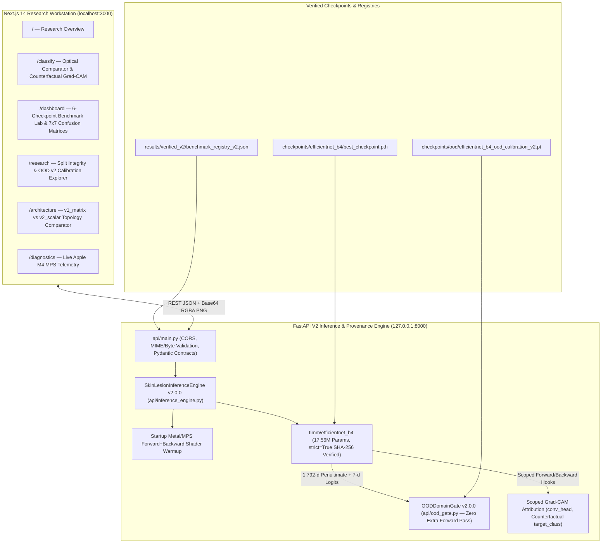

# DermAI Research Platform V2 — System & Model Architecture Specification

**Document Version:** 2.0.0  
**Active Deployment Target:** Apple Silicon MacBook M4 (16 GB Unified Memory, PyTorch MPS)  
**Historical Training Reference:** Lenovo LOQ (NVIDIA RTX 3050 6 GB Laptop GPU, CUDA)  

---

## 1. End-to-End Platform Architecture

---

## 2. Deployed Inference Backbone: `EfficientNet-B4`

- **Implementation:** `timm.create_model("efficientnet_b4", pretrained=False, num_classes=7)`
- **Checkpoint Path:** `checkpoints/efficientnet_b4/best_checkpoint.pth`
- **Cryptographic SHA-256:** `125340ffa59ca4a18fb0cd0bdca024eae9ca2fe3ce54d1f230b465bd9ad9658e`
- **Learnable Parameters:** `17,561,167` (`17.56M`), loaded with `strict=True` (0 missing keys, 0 unexpected keys).
- **Deterministic Preprocessing Contract (`ham10000_eval_r256_c224_imagenet_v1`):**
  1. `PIL.Image.convert("RGB")`
  2. `transforms.Resize((256, 256), interpolation=BILINEAR)`
  3. `transforms.CenterCrop((224, 224))`
  4. `transforms.ToTensor()` (`[0.0, 1.0]` `float32`)
  5. `transforms.Normalize(mean=[0.485, 0.456, 0.406], std=[0.229, 0.224, 0.225])`
- **Canonical 7-Class Output Ordering (`ham10000_alphabetical_7class_v1`):**
  - `0: akiec`, `1: bcc`, `2: bkl`, `3: df`, `4: mel`, `5: nv`, `6: vasc`

---

## 3. Single-Pass OOD Domain Gate v2.0.0 (`api/ood_gate.py`)

Unlike Legacy V1—which instantiated a separate feature extraction pass and compared against 7 demo files—`OODDomainGate` v2.0.0 reuses the `1,792`-dimensional penultimate embedding $\mathbf{h} \in \mathbb{R}^{1792}$ and `7`-dimensional logit vector $\mathbf{z} \in \mathbb{R}^7$ already computed during `EfficientNet-B4`'s forward pass:

1. **Sub-Cluster Prototype Cosine Similarity ($s_{\text{proto}}$):** Maximum cosine similarity between $\hat{\mathbf{h}} = \mathbf{h} / \|\mathbf{h}\|_2$ and 49 L2-normalized class sub-cluster centroids (7 classes $\times$ 7 k-means centroids fitted on `splits/train.csv`).
2. **Diagonal Mahalanobis Score ($s_{\text{maha}}$):** Normalized precision-weighted distance to the closest class distribution $(\boldsymbol{\mu}_c, \boldsymbol{\sigma}_c^2)$ fitted on `splits/train.csv`.
3. **Logit Free Energy Score ($s_{\text{energy}}$):** Derived from $-T \log \sum_{c=1}^7 \exp(z_c / T)$, normalized via training-set percentiles.
4. **Photometric Envelope ($p_{\text{photo}}$):** Soft penalty for non-dermoscopic color cast (cold blue dominance), extreme saturation/blankness, or pure grayscale frames.

$$\text{DomainScore}(\mathbf{x}) = p_{\text{photo}}(\mathbf{x}) \cdot \left(0.50 \, s_{\text{proto}} + 0.30 \, s_{\text{maha}} + 0.20 \, s_{\text{energy}}\right)$$

Inputs with $\text{DomainScore}(\mathbf{x}) < 0.2500$ are rejected (`status: "rejected"`) before classification probabilities or Grad-CAM overlays are emitted.

---

## 4. Scoped Single-Pass Grad-CAM & Counterfactual Attribution

In `SkinLesionInferenceEngine.predict_and_explain(image, target_class, alpha)`:
1. Forward and backward hooks are registered **per-request** on `self.model.conv_head` inside a `try ... finally` block and immediately removed (`h_fwd.remove()`, `h_bwd.remove()`) once the backward pass completes.
2. A **single** forward pass computes `feats = self.model.forward_features(x)`, `penultimate = self.model.forward_head(feats, pre_logits=True)`, and `logits = self.model.get_classifier()(penultimate)`.
3. `OODDomainGate.validate_from_features(rgb_image, penultimate.detach(), logits.detach())` runs immediately. If rejected, no backward pass is executed.
4. If accepted, the target class index $c^*$ is set to either the user-requested counterfactual `target_class` or $\arg\max_c \text{logits}_c$.
5. `logits[0, c*].backward(retain_graph=False)` computes spatial gradients $\frac{\partial z_{c^*}}{\partial A^k_{ij}}$ at `conv_head`, which are global-average-pooled across spatial dimensions, weighted against activations $A^k$, ReLU-filtered, and bicubically upsampled to $224 \times 224$.
6. Both a standalone transparent RGBA heatmap (`heatmap_base64`) and a blended overlay (`overlay_base64`) are returned so the frontend Optical Comparator can adjust opacity in real time ($0\text{--}100\%$) without re-invoking the backend.

---

## 5. Experimental Dual-Branch CNN (`models/dual_branch_net.py` & `models/fusion.py`)

`DualBranchNet` decouples feature extraction into two parallel streams:
- **`ShallowWideBranch` (`models/shallow_wide_branch.py`):** 3 convolutional blocks ($3 \to 256 \to 512 \to 1024$) with a single $2 \times 2$ max-pool, preserving a $112 \times 112$ spatial grid before Global Average Pooling (`6,035,456` parameters).
- **`DeepNarrowBranch` (`models/deep_narrow_branch.py`):** $7 \times 7$ stem ($64$ channels, transferred from DenseNet-121) followed by 4 narrow residual stages ($64 \to 128 \to 128 \to 128$) and a $1 \times 1$ bottleneck ($256$ channels at $14 \times 14$, `1,961,216` parameters).
- **`AttentionFusionHead` (`models/fusion.py`):** Explicitly supports both historical checkpoint topologies:
  - `fusion_version="v1_matrix"`: `Linear(1280 -> 1280)` sigmoid gate (`10,669,639` total model params; used by `seed_123` and `seed_999`).
  - `fusion_version="v2_scalar"`: `Linear(1280 -> 1)` scalar sigmoid gate (`9,031,241` total model params; used by `seed_42`).
